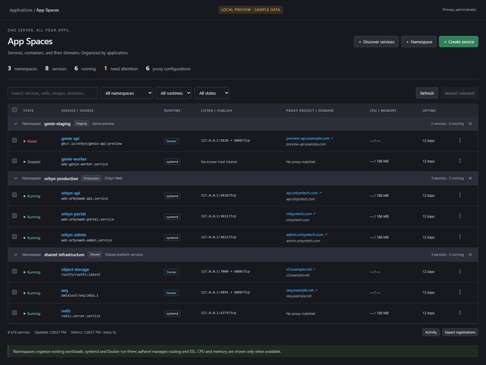
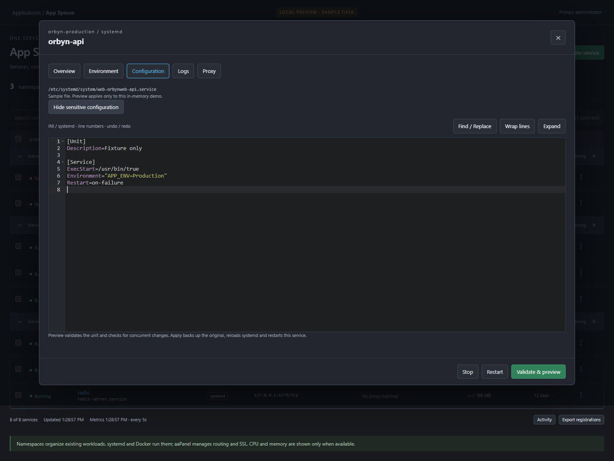
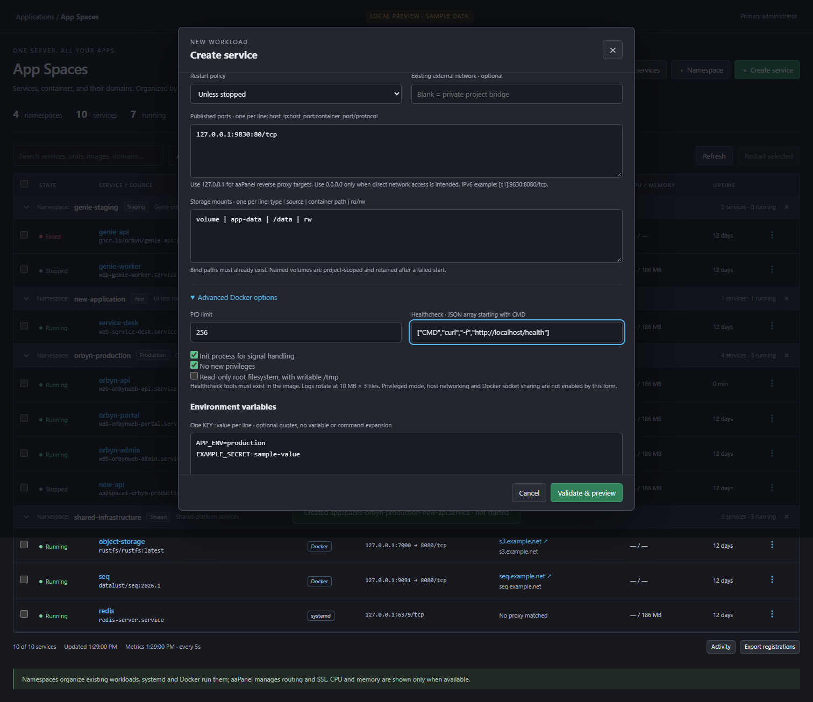
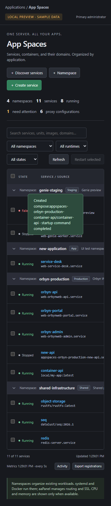

# App Spaces for aaPanel

**Organize your systemd services and Docker containers into application namespaces, all inside aaPanel.**

App Spaces is an [aaPanel](https://www.aapanel.com/) plugin for servers that run many apps side by side, such as a .NET API as a systemd unit, a Node portal, a Redis service and a few Docker containers. It puts them on one screen, grouped by application (for example `shop-production`, `shared-infrastructure` and `blog-staging`). For each service it shows the live state, its ports, the aaPanel reverse-proxy domain it serves, CPU/RAM and uptime, along with its logs, environment and configuration.



> systemd and Docker still run your workloads, and aaPanel still manages proxies and SSL. App Spaces adds organization, visibility and guarded controls on top. Grouping services into namespaces changes only plugin metadata. It never moves or recreates anything.

---

## Contents

- [Features](#features)
- [Screenshots](#screenshots)
- [How it works](#how-it-works)
- [Requirements](#requirements)
- [Installation](#installation)
- [Usage](#usage)
- [Security model](#security-model)
- [Project layout](#project-layout)
- [Development](#development)
- [Limitations](#limitations)
- [Contributing](#contributing)
- [License](#license)

## Features

**Inventory and organization**
- Create and delete namespaces. Register, unregister and move workloads between them. Everything is stored in SQLite.
- Discover existing systemd services and Docker containers. Compose replicas are grouped by their project/service labels.
- An **Extra** group, kept last and collapsed, holds anything you have not organized yet.

**Live visibility**
- The real process state from systemd and Docker: Running, Starting, Stopped, Failed, Restarting, Unknown or Unavailable.
- Host TCP listeners and published Docker ports.
- CPU and RAM read from cgroup v2, refreshed every 5 seconds while the tab is visible. Metrics that can't be read show as *unavailable* and are never made up.
- Uptime, bounded journal and container log tails, and environment inspection where values stay hidden until you reveal them.

**Proxy awareness**
- Reads aaPanel's Nginx vhosts (read-only) to show which domains and routes point at each workload. It handles multiple routes per workload and matches local addresses.

**Safe controls (opt-in per workload)**
- Start, stop and restart, with confirmation prompts, per-service operation locks, replay protection and an activity history.
- **systemd unit editor**: hidden until you reveal it, then edit, check syntax and review a redacted diff. It detects edits made by someone else in the meantime. Applying needs a 5-minute session-bound token. The editor backs up the original, writes atomically, reloads the daemon and restarts the unit. If the restart fails it rolls back.

**Create-service wizard**
- Presets for **.NET**, **Node**, **registry image** and **local Dockerfile**.
- Set paths, arguments, environment variables (one per line), restart and boot behavior, Docker ports, mounts and network, resource limits, a health check and process options.
- Validate first, then choose **Create** or **Create & Start**. It only creates new systemd units with the plugin's prefix or Compose projects the plugin owns, and never overwrites an existing definition.

**aaPanel integration**
- Opens in its own authenticated tab at `/app-spaces`, with a shortcut button next to **Supervisor** in Proxy Project.

## Screenshots

| Overview | Configuration editor |
|---|---|
|  |  |

| Create service wizard | Mobile |
|---|---|
|  |  |

*Screenshots come from the bundled fixture preview (`preview/index.html`) and use sample data.*

## How it works

```
Server
 └── Namespace (application / environment grouping, plugin metadata only)
      └── Registered workload
           ├── systemd unit        → systemctl / journalctl / cgroup
           └── Docker container(s) → docker inspect / logs / Compose labels
                └── linked aaPanel Nginx proxy routes and domains (read-only)
```

- **Backend** (`app_spaces/app_spaces_main.py`, `app_spaces/appspaces_core/`): Python standard library only. The aaPanel API entry point authenticates every request and dispatches to inventory adapters, the proxy parser, storage, the config editor and the creation service.
- **Frontend** (`ui.html`, `ui.css`, `ui.js`, `creation_ui.js`): plain JS. `tools/assemble_ui.py` combines these into the self-contained `index.html` and `workspace.html` that aaPanel loads.
- **Storage**: SQLite in `app_spaces/data/`. It is private to the server and never packaged.

See [docs/ARCHITECTURE.md](docs/ARCHITECTURE.md) and [docs/CREATION.md](docs/CREATION.md) for details.

## Requirements

- A Linux server running aaPanel, with Python 3.9 or later in aaPanel's runtime. No third-party Python packages are needed.
- `systemctl`, `systemd-analyze`, `journalctl`, `ss` and `ip` for the systemd features.
- Optional: the Docker CLI/daemon and the Compose v2 plugin for the Docker features. If Docker is missing, the systemd features still work.
- Nginx vhosts in `/www/server/panel/vhost/nginx` for proxy matching.
- An aaPanel **primary administrator** session.

## Installation

**See [INSTALL.md](INSTALL.md) for the full step-by-step guide.** Quick version:

```bash
# on your machine
python tools/build.py                 # -> dist/app_spaces-0.0.1.zip

# on the server, as root
unzip app_spaces-0.0.1.zip -d /www/server/panel/plugin/
bash /www/server/panel/plugin/app_spaces/install.sh install
```

Then refresh aaPanel and open **App Spaces** from the plugin list, or use the shortcut in Proxy Project.

## Usage

1. **Create a namespace**, such as `shop-production`.
2. **Discover services** and register the systemd units and containers that belong to it.
3. Check status, ports, linked domains, metrics and logs in the table. Click a service to open its details.
4. Optionally, **turn on lifecycle and config permissions** for a workload to use start/stop/restart and the unit editor. They are off by default.
5. Use **Create service** to define a new systemd unit or Compose workload from a preset.

Try it locally without a server: open `preview/index.html` in a browser. It runs entirely in memory on sample fixtures.

## Security model

- Every API call requires the aaPanel session of the primary admin (`uid=1`) and a valid CSRF token (`x-http-token`). Temporary login links and API-only credentials are rejected.
- There is no generic command-execution endpoint. Only fixed, validated operations are available.
- Every change needs a fresh random request ID, and IDs are kept for 24 hours to reject replays. Lifecycle and apply operations hold a file lock for each workload.
- Secrets are redacted in diffs and creation previews, and environment values stay hidden until you reveal them.
- The audit log records who did what to which target and the outcome. It never stores configuration contents.
- `app_spaces/data/` holds registrations, the audit log and unit backups. Treat it as sensitive and **never commit it**. It is listed in `.gitignore`.

Report vulnerabilities privately (see [CONTRIBUTING.md](CONTRIBUTING.md)), not in public issues.

## Project layout

```
app_spaces/                 the plugin itself (this folder is what gets installed)
  app_spaces_main.py        aaPanel API entry: auth, CSRF, dispatch
  appspaces_core/           core.py (inventory, proxy, storage, config editor),
                            creation.py (wizard backend), metrics.py
  panel_integration.py      installs the Proxy Project shortcut and /app-spaces route
  workspace_routes.py       workspace URL handler
  ui.html ui.css ui.js creation_ui.js   UI sources you edit
  index.html workspace.html launcher.html   generated, do not edit by hand
  info.json icon.png install.sh
preview/                    standalone fixture preview (demo.js + vendored Ace editor)
tests/                      Python unittest suites + Playwright browser checks
tools/assemble_ui.py        rebuilds the generated HTML from the UI sources
tools/build.py              builds dist/app_spaces-<version>.zip
docs/                       architecture, creation, install/operations, validation
docs/design/                original design mockup and plan (historical)
docs/images/                README screenshots
```

## Development

```bash
python tools/assemble_ui.py                 # after any change to ui.* / creation_ui.js
python -m unittest discover -s tests -v     # backend tests (52)
python tools/build.py                       # package the plugin zip
```

Browser checks (Playwright):

```bash
npm install --no-save playwright
node tests/ui.spec.cjs        # UI flows on the fixture preview; screenshots -> test-results/
node tests/host.spec.cjs      # aaPanel host integration (shortcut, auth, metrics cadence)
# use a system browser: BROWSER_CHANNEL=msedge (or chrome)
# reuse an existing install: PLAYWRIGHT_MODULE=/path/to/node_modules/playwright
```

CI runs the assembly check, the unit tests and the package build on every push. See [.github/workflows/ci.yml](.github/workflows/ci.yml).

## Limitations

- Manages only the local server. Remote and multi-server management is not supported.
- The proxy adapter understands a conservative subset of Nginx syntax. It doesn't support `include` expansion, Unix sockets or variable/DNS upstreams, and it reports matches as inferred, not authoritative.
- The unit editor edits only the main unit file. `EnvironmentFile` contents are not editable, and drop-ins are listed but not edited.
- Docker metrics require cgroup v2.
- Not yet validated on a live production aaPanel. See [docs/VALIDATION.md](docs/VALIDATION.md). Pilot it on a disposable workload first.

## Contributing

Issues and pull requests are welcome. Read [CONTRIBUTING.md](CONTRIBUTING.md) first.

## License

[MIT](LICENSE) © Orbyn Technologies
